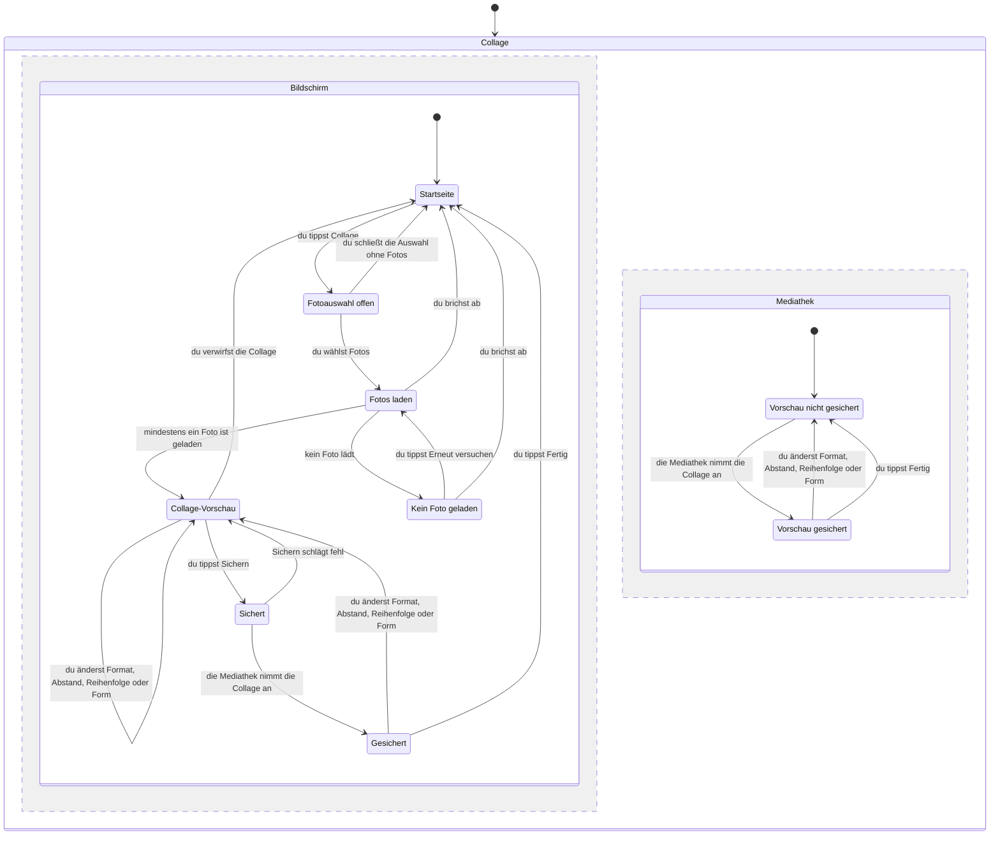

# iOS Collage mode

## Problem

A second mode next to single-photo framing: pick 1 to 12 photos, arrange them on one white canvas with a live
preview, and save one JPEG to the library. The same pixel rects must drive the preview and the full-resolution
render, twelve 12 to 48 MP originals cannot stay decoded, and a load or save that finishes after the user cancelled
must never move the screen.

## Decisions

- **One owner per concern.** `CollageDocument` (1...12 photos with stable ids, order, per-photo shape, settings)
  owns the collage and the copies of its originals; dropping the last copy deletes them. `CollageLayout` is a pure
  function of the document. `CollagePhase` is the whole screen state, owned by `CollageSession`.
- **Rows by geometric mean of photo areas.** Of all `2^(n-1)` ways to cut the ordered photos into justified rows,
  take the one with the largest `sum(k * ln h)` at the widest block that fits. "Block aspect closest to the canvas"
  picks `[1, 11]` for 12 portrait photos on 3:4; the geometric mean picks `[3, 3, 3, 3]`. Ties go to fewer rows,
  then to fewer photos in the first rows. Spacing stays exact in pixels; only the choice uses `Double`.
- **The layout is total.** Canvas sides >= 1440, spacing <= 150, at most 12 photos and cell aspects clamped to
  1:5...5:1 always leave a split that fits. A sweep test pins it, so the layout has no failure state.
- **Panoramas beyond 5:1 are centre-cropped to 5:1. Small photos may be scaled up to their cell** (collage only;
  `FrameLayout` keeps its no-upscale rule). Every cell shows the centred cover crop of its photo, which is also how
  `square` is drawn.
- **Saved is an editor state.** `edit` works in `editing` and `saved`; in `saved` a change returns to `editing`, a
  no-op keeps `saved`. So the screen says "Gesichert" only while exactly the shown preview is in the library.
- **Late results.** Every phase change goes through `enter`, which counts runs and abandons the transfer in flight.
  A load checks the count after each `await`. Nothing leaves `saving` but the save's own result.
- **Settings** (canvas, spacing, all-photos shape) are written on every edit that changes them and read when the
  next collage opens. Order and single-photo shapes belong to one collage.
- **"Erneut versuchen" reloads the same pick.** The saved file is named `Collage-passepartout.jpg`.
- **The shell holds `beginBackgroundTask` while saving** (`SaveKeepAlive`); the kit stays UIKit-free.
- **Three formats.** 3:4 (1440x1920), 1:1 (1440x1440) and 3:2 (2160x1440); 3:4 and 3:2 are the single-photo
  targets of `CONTEXT.md`. 4:5 is gone. A stored `"4:5"` is an unknown name now and gives the field's default,
  3:4, like any other unknown value, so there is no compatibility code.
- **The editor is one screen that never scrolls.** "Abbrechen" and "Sichern" sit in the navigation bar, whose
  centre shows "Sichert …" and "Gesichert". The stage takes the height that is left, with the format glyphs on it
  directly above the paper. One inspector below holds the spacing and one shape row: it sets all photos while
  none is selected and the selected photo otherwise. Text grows up to `accessibility1`.
- **Reorder by dragging in the collage, committed on the drop.** The layout stays still while the finger is down
  and the target photo is marked. A justified layout re-cuts its rows on every reorder, so a live reflow would
  move the targets away. `CollageLayout.dropIndex(x:y:)` is the rule for the target: the photo containing the
  point, else the nearest, ties to the earlier one. The drop calls `move(_:to:)`. VoiceOver reorders with the
  actions "Nach vorne" and "Nach hinten".
- **Extractions first.** `PhotoPixels.swift` (decode, crop, resample, white canvas, JPEG) and `OriginalTransfer.swift`
  (handover, stall timeout, abandon) came out of `PhotoFramer` and `FramingSession` before any collage code, so both
  modes share one quality path and one background-kill rule.

## Statechart



Rule: the screen shows "Gesichert" only while exactly this preview is in the library. TLC on the chart: 13 states,
37 transitions, `SavedMeansInLibrary` holds. The first draft had `Gesichert --> Collage-Vorschau : du bearbeitest
weiter` and allowed edits on "Gesichert"; TLC found "Sichern, die Mediathek nimmt an, du änderst etwas" ending on
"Gesichert" with an unsaved preview. Making every edit on "Gesichert" lead to "Collage-Vorschau" fixed it.
Every edge is a `CollageSessionTests` test. Regenerate from the block above saved as `collage.mmd`:

```bash
TLA2TOOLS=~/.local/share/tla/1.7.4/tla2tools.jar node ~/.claude/skills/statechart/scripts/statechart.mjs \
  from-chart collage.mmd --title Collage
```

## Red-green evidence

Each unit's tests ran red against stubs before the code existed (`swift test --package-path ios/PassepartoutKit
--filter <Suite>`). The extraction commit had no red phase; its only test edit is the `decodeLongEdge` call site.

| Unit | Red against stubs | Green |
| --- | --- | --- |
| Settings | 6 of 8 failed | 8 |
| Document and layout | 14 of 17 failed | 17 |
| Renderer | 7 of 8 failed | 9 |
| Session | 24 of 25 failed | 27 |
| Three formats and the drop target (editor redesign) | 5 of 5 new tests failed | 100 in all suites |

`make -C ios check`: 95 tests in 10 suites pass on the Mac and on the iOS 26.5 simulator (34 before).

23 hand mutants ran against the collage suites. Three survived at first and each got a test:
`startingOverBeforeTheFirstLoadRanLoadsOnlyTheNewPick` (no run check in the load loop),
`leavingTheAppKeepsALoadThatCanRunInTheBackground` (leaving the app abandons every transfer) and
`keepsDetailThePreviewHasLost` (the export scales the 1000 px preview up instead of reading the original).
Two are equivalent: no minimum row height, and no rounding guard on the block height. Without both, 100,000 random
documents gave no cell under 1 px. Both guards stay, so "every cell is at least 1 px" holds by construction and not
only because the score never picks a degenerate split.

The editor redesign ran `make -C ios lint test build` only. No simulator ran, so the drag, the haptics and the
bar heights on iOS 26 are not yet seen on a device.

## Lessons

- Run the red phase for real. Against an empty layout two tests passed, which would have stayed hollow.
- A tolerance needs the unit of the guarantee. "Within 1 %" was wrong for 77 px cells; "whole pixels" is the rule.
- Flat-colour test images cannot tell a full-resolution export from an upscaled preview. Use detail finer than the
  preview can hold.
- iOS 26 draws a tick for every `step` of a `Slider`. The spacing slider has none and rounds in its binding.
- Measure CPU time, not wall time, on a shared host. Integer loops in the split search made a debug-build 12-photo
  layout 7.6x faster (36 ms to 4.8 ms), which keeps the spacing slider smooth.
